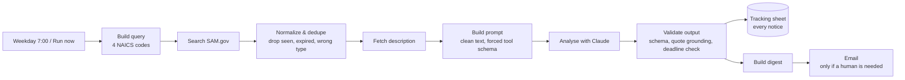

# RFP Scout

An n8n workflow that finds new federal software opportunities every weekday morning, reads each one with Claude, and emails a bid team a ranked shortlist, with every notice logged to a tracking sheet.

It is built around one question: **how do you let an LLM do the first read of a document that people will act on, without trusting it blindly?** Most of the engineering here is the answer to that, not the happy path.



## What it does

1. Searches the SAM.gov Opportunities API for software and IT notices (NAICS 541511, 541512, 541519, 518210) posted in the last 3 days.
2. Keeps solicitations, combined synopses, presolicitations and sources-sought notices that are active, not expired, and not already analysed.
3. Fetches each description, strips it to text, and asks Claude for a structured analysis (summary, scope, requirements with evidence quotes, deadline, set-aside, clearance, fit score, recommendation, risks) against a company profile you edit in one place.
4. **Validates the answer** (below), then logs every notice to Google Sheets.
5. Emails one digest: *Pursue*, *Worth a look*, and *Needs a human*. No email on quiet days.

## Where the AI fails, and how it is caught

| Failure | How it is caught | What happens |
|---|---|---|
| Model invents a requirement or quote | Every `evidence_quote` must appear verbatim (whitespace and case-insensitive) in the source document | Requirement dropped, `pursue` downgraded to `review`, row flagged `ungrounded_quotes:N` |
| Model states the wrong deadline | Compared with SAM.gov's own `responseDeadLine` | Metadata wins, row flagged `deadline_mismatch` |
| Model is confident on a stub document ("see attachment") | Source under 300 characters | Score capped at 60, never `pursue`, flagged `thin_source` |
| Malformed or out-of-range output | Schema check on every field | Flagged `schema_invalid:<field>`, nothing trusted |
| Output cut off by the token limit | `stop_reason == max_tokens` | Flagged `output_truncated` |
| Very long document | Truncated at 24,000 characters | Flagged `document_truncated` |
| API outage or rate limit | 3 retries, then continue-on-error | Row logged as `llm_call_failed`, **not** marked seen, so the next run retries it |
| Clearance-gated work | Model extracts `clearance_required` | Flagged `clearance_required` so it is not mistaken for a clean fit |

Nothing is silently dropped. A doubtful row appears in the digest under "Needs a human" with the reason beside it.

## Measuring it

`eval/cases.json` holds labelled cases (a clear fit, a hardware buy, a clearance-gated job, a stub, and a deadline trap that tests whether the model invents a value when the document has none). `eval/run-eval.js` runs the **same prompt and the same validator** the workflow uses and reports recommendation agreement, how many rows the validator flagged, how many raw quotes were fabricated, and how often the model invented a value for a null field.

```powershell
$env:ANTHROPIC_API_KEY = "sk-ant-..."
node eval/run-eval.js
```

The cases are synthetic and few; they are a regression harness for prompt changes, not a benchmark. Add real notices (and the decision the bid team made) as you collect them.

## Setup

1. Free SAM.gov API key: create an account at sam.gov, then request a key under Account Details.
2. `npx n8n`, open http://localhost:5678, import `workflows/rfp-scout.json`.
3. Create credentials and attach them:
   - **SAM.gov**: *Query Auth*, name `api_key`, value your key. Used by *Search SAM.gov* and *Fetch description*.
   - **Anthropic**: *Header Auth*, name `x-api-key`, value your key. Used by *Analyse with Claude*.
   - **Google Sheets** and **Gmail**: OAuth2.
4. Make a Google Sheet with a tab named `Opportunities` whose first row is `sheet-headers.csv`, and select it in *Log to tracking sheet*.
5. Click **Run now**, check the sheet, then set the workflow **Active**.

Edit `code/*.js`, then `node build-workflow.js` and re-import. Run `node test/pipeline.test.js` before importing (no network or keys needed).

## Design decisions

- **Forced tool call, not "reply in JSON".** The model must call `record_analysis`, so the output matches a schema instead of being parsed out of prose.
- **Validation lives in code, not in the prompt.** Prompts reduce errors; checks catch the ones that remain.
- **"Seen" is recorded after success.** Marking notices seen at fetch time would permanently lose any that failed mid-run.
- **Capped per run (25).** Bounds spend on a busy day; the rest roll to the next run.
- **Prompt, schema and company profile are plain files** (`code/build-prompt.js`) shared by the workflow and the eval, so the eval cannot drift from production.

## When not to use n8n

n8n is the right tool here: a scheduled pipeline of HTTP calls, light transformation, and delivery to Sheets and email, owned by one person and readable by non-engineers. It stops being the right tool when:

- **Logic dominates wiring.** Once most nodes are Code nodes (as the three here nearly are), the visual canvas adds little and the code wants tests, types and code review. That is why the logic lives in `code/` with its own test suite and the JSON is generated.
- **Volume or latency matters.** Per-item HTTP chains and workflow static data do not scale to thousands of items per run or to sub-second responses.
- **State is real data.** Static data is a convenient "seen" list, not a database. If several workflows or people need the same state, use a real table.
- **Many teams edit it.** Visual workflows diff badly in git and are easy to break by clicking. Past a few owners, move to code with CI.
- **A simple tool already exists.** If a Zapier zap or a SaaS integration does the job and someone else maintains it, build nothing.

## Rolling it out to a team

A tool nobody uses saved no time. The plan alongside the build:

1. **Shadow week.** Run alongside the current manual process and compare what each finds. Fix prompt and profile gaps with the people who do the work.
2. **Make the profile theirs.** The bid team edits `COMPANY_PROFILE` and the NAICS list; they decide what "fit" means.
3. **Keep the human decision visible.** The sheet has the model's call; a column for the team's actual decision turns every notice into a new eval case.
4. **Review flagged rows weekly.** The `review_reasons` counts show which failure is most common and what to fix next.
5. **Measure the time back.** Hours per week spent on manual triage before and after.

## Caveats

- The SAM.gov response shape was written from the public API docs; check the first live run against the real payload, in particular the `description` link and the date formats.
- Attachments (the PDFs on a notice) are not read; only the description text is. That is the most valuable next step, and the main reason many rows will show `thin_source`.
- Fit scores are the model's judgement against the profile you wrote. Treat them as ordering, not as probabilities.
